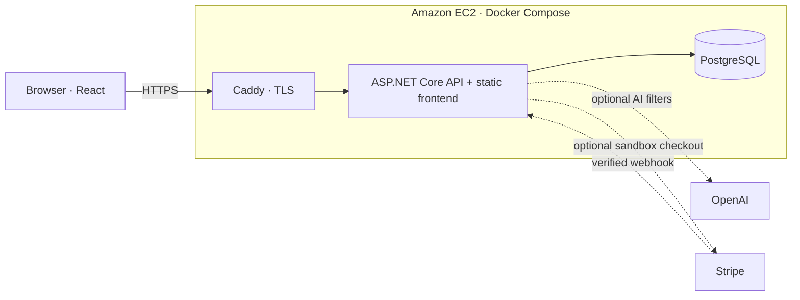

# Gather

**Good plans. Better together.**

A full-stack event platform for discovering local events, booking tickets, and checking attendees in at the door. Built with a custom ASP.NET Core backend and PostgreSQL, with React and TypeScript on the frontend.

[Visit the AWS demo](https://3.106.146.99/) · [Deployment source](https://github.com/danhqm/Gather/tree/aws-demo) · [Operations guide](https://github.com/danhqm/Gather/blob/aws-demo/docs/operations.md)

> This is a portfolio demo with fictional events and sandbox payments. The AWS instance may be stopped between demonstrations, so the demo URL is not always available.

## What you can do

- **Discover events** by category, city, price, and date across Kuala Lumpur and George Town.
- **Search in plain language** with OpenAI-assisted filters that remain visible and editable.
- **Reserve and book** 1–4 admissions, with expiring holds, free booking confirmation, and Stripe sandbox checkout.
- **Keep your tickets** in an authenticated account and open a QR admission code.
- **Check attendees in** using a camera or manual code, with repeated admission rejected.
- **Manage events** as an organiser: create drafts, edit details, publish, and unpublish.

The responsive interface uses Inter typography, a lime/ink/paper palette, animated event passes, illustrated posters, and a motion pause control.

## Technology

| Layer | Implementation |
| --- | --- |
| Frontend | React, TypeScript, Vite, CSS |
| Backend | C#, ASP.NET Core 10, ASP.NET Core Identity |
| Database | PostgreSQL 18, Entity Framework Core |
| AI | OpenAI Structured Outputs, server-side filter validation and usage limits |
| Payments | Stripe sandbox checkout and verified webhooks |
| Tickets | QR admission codes, camera scanning, manual check-in |
| Containers | Docker multi-stage build and Docker Compose |
| Hosting | Amazon EC2, encrypted EBS storage, Elastic IP, Caddy HTTPS |
| Verification | .NET tests with disposable PostgreSQL containers, Playwright browser tests, live smoke checks |

## Deployment status

The first AWS deployment was verified on **10 November 2026** in Sydney (`ap-southeast-2`). It runs Caddy, the application, and PostgreSQL on one EC2 instance. PostgreSQL is private to the Docker network; public traffic enters through HTTPS.

| Capability | Local demo | AWS demo |
| --- | --- | --- |
| Catalogue, signup and sign-in | Implemented and tested | Smoke-tested |
| Free booking, tickets and check-in | Implemented and tested | Smoke-tested, including duplicate-admission rejection |
| Stripe sandbox paid checkout | Paid test booking confirmed and ticket issued | Not configured |
| OpenAI-assisted search | Evaluated and manually verified | Not configured |
| Camera admission | Manually verified | Browser camera flow not separately verified on AWS |
| Persistence | Docker volumes | Booking, admission and session persistence verified after app recreation |

`main` contains the local application. The `aws-demo` branch contains the deployed configuration and deployment fixes, including trusted proxy handling, the private Docker network allocation, and non-root container file permissions.

## Architecture



The browser talks to one origin. Identity, permissions, reservations, payment verification, and ticket admission are handled by the backend. The optional OpenAI and Stripe connections are enabled in the local demo and remain unconfigured in the AWS deployment.

## Run locally

Requires Docker Desktop with its Linux engine running.

1. Copy `.env.example` to `.env` and replace the password with a random local password. If this workspace already has `.env`, keep it: the database volume was initialized with that password.
2. Run from this directory:

   ```powershell
   docker compose up --build -d
   ```

3. Open **http://localhost:8080**. The API and frontend share one origin. The database is available only on localhost port `54329`.

The first startup runs migrations and seeds seven fictional November 2026 events: six public and one draft. Restarting preserves data in the `postgres_data` Docker volume. `docker compose down` stops the app while preserving that volume. Removing the volume deletes the local data.

To see startup errors: `docker compose logs app`. To check database connectivity: `http://localhost:8080/api/health`.

## Develop without rebuilding Docker

Use the .NET 10 SDK and Node 24 LTS.

Start only PostgreSQL with `docker compose up -d postgres`. In one PowerShell terminal:

```powershell
$env:ConnectionStrings__Database = 'Host=localhost;Port=54329;Database=gather;Username=gather;Password=YOUR_LOCAL_PASSWORD'
$env:Database__Initialize = 'true'
$env:Demo__Seed = 'true'
dotnet run --project src/EventPlatform.Api --launch-profile http
```

In another terminal:

```powershell
npm --prefix src/EventPlatform.Web ci
npm --prefix src/EventPlatform.Web run dev
```

Open `http://localhost:5173`. Vite proxies `/api` to port `5226`.

## Verify

With Docker running:

```powershell
dotnet test EventPlatform.sln
npm --prefix src/EventPlatform.Web run build
# Start the Compose application first; the browser tests use http://127.0.0.1:8080.
npm --prefix src/EventPlatform.Web run test:e2e
```

Tests create disposable real PostgreSQL containers. Browser tests use installed Microsoft Edge for desktop and mobile viewport checks. On a machine without Edge, install it with `npx playwright install msedge` from the web directory, or change the test configuration to your available browser. Set `BASE_URL` to test another local origin.

## Catalogue and data rules

```text
React catalogue → GET /api/events → EF Core query → PostgreSQL
Event details   → GET /api/events/{id}
Calendar dates  → GET /api/date-window → UTC bounds → catalogue query
```

The server excludes unpublished events for both list and detail reads. Prices use integer minor units; price filters require a currency. Dates are stored as UTC instants with the event's IANA timezone. Calendar-day conversion happens on the server so a visitor's computer timezone cannot change the selected day. Date upper bounds are exclusive. Pagination is bounded and sorted by start time then ID.

The local city choices currently share `Asia/Kuala_Lumpur`; adding cities in other timezones requires extending that mapping. Ambiguous or missing midnight boundaries return a validation error. Demo dates are fixed in November 2026; update the seed data for later demonstrations on a fresh database.

`compose.yaml` runs the local environment without AWS or OpenAI credentials. For the hosted environment, use the [production Compose file](https://github.com/danhqm/Gather/blob/aws-demo/compose.production.yaml) and [deployment guide](https://github.com/danhqm/Gather/blob/aws-demo/docs/operations.md) on `aws-demo`. Keep `.env` and `.env.aws` outside Git.

References: [Vite prerequisites](https://vite.dev/guide/), [PostgreSQL Docker data persistence](https://docs.docker.com/guides/postgresql/immediate-setup-and-data-persistence/).

## Accounts and permissions

Use **Sign in → Create an account** to register a customer. Passwords require 12–128 characters with uppercase, lowercase, a number and a symbol. Public signup never creates an organisation membership. Login failures use a generic message; five failed attempts lock the account for 15 minutes, and authentication endpoints allow at most 20 requests per IP per minute.

For local organiser/staff accounts, set `DEMO_ACCOUNT_PASSWORD` in `.env` before starting the app. Choose a strong password before the initial seed. Accounts are `organiser@gather.test` and `staff@gather.test`. Restarting does not reset an existing password. Never publish that `.env` file or use these demo accounts for real customer data.

Identity hashes passwords and issues an HttpOnly session cookie. Production cookies require HTTPS. Local Compose uses HTTP on localhost. Every authenticated mutation, signup and login requires the `X-CSRF-TOKEN` header; fetch its current value from `/api/auth/csrf` after an identity change. Keys used to protect cookies persist in the `data_protection_keys` Docker volume. Treat that volume as sensitive; it is not a replacement for production key protection and backup policy.

Email verification and password recovery are not implemented in this portfolio milestone. Use test addresses. Accounts and events persist in the local PostgreSQL volume.

## Organiser dashboard

Sign in as the local organiser, then choose **Manage events**. Create a draft, edit its details, publish it into discovery and unpublish it again. Public users cannot read drafts. Every management endpoint checks the event's organisation membership on the server; a customer or another organisation's organiser cannot change it.

This demo deliberately supports Kuala Lumpur and George Town, Malaysia time, MYR prices and one general-admission capacity per event. The editor accepts an optional HTTPS image URL; hosted image uploads come later. An empty or failed image uses the illustrated poster. Events must start in the future before publication. The dashboard shows the newest 200 events; pagination is needed before using it for a larger catalogue.

Browser organiser tests read `DEMO_ACCOUNT_PASSWORD` from the ignored local `.env` (or the process environment), and skip that journey if it is absent. Tests run serially because publishing changes the shared local catalogue; they unpublish their demo events when finished.

References: [ASP.NET Core Identity](https://learn.microsoft.com/en-us/aspnet/core/security/authentication/identity?view=aspnetcore-10.0), [antiforgery tokens](https://learn.microsoft.com/en-us/aspnet/core/security/anti-request-forgery?view=aspnetcore-10.0).

## Reservations

Signed-in customers can hold 1–4 admissions for 35 minutes, restore the hold after refreshing, and cancel it. The countdown uses server time even when the browser clock is wrong. Holds are demo reservations. Free bookings can be confirmed; paid checkout becomes available only after sandbox configuration.

PostgreSQL event-row locks serialize capacity changes. Expired holds stop counting immediately, independently of the cleanup worker. Request IDs make retries return the original booking. Price, capacity and start time become immutable after the first booking; unpublishing blocks new holds and preserves existing ones.


## Sandbox checkout status

The local Stripe sandbox smoke test confirmed a paid test booking and issued a ticket. Staff verified manual and camera admission, including rejection of a repeated manual check-in. See [sandbox setup](docs/stripe-sandbox.md).

## AI event search

Signed-in users can describe an event in plain language. Gather uses OpenAI to propose filters, validates the result, then runs the usual PostgreSQL catalogue search. Users can edit the filters and search manually at any time.

To enable locally, set `OPENAI_API_KEY` and `OPENAI_SEARCH_ENABLED=true` in the ignored `.env`, then run `docker compose up --build -d app`. Keep the key in backend configuration. The app uses GPT-6 Luna with [OpenAI Structured Outputs](https://developers.openai.com/api/docs/guides/structured-outputs?api-mode=responses).

The database counts all outbound attempts, including retries, against 20 per user and 100 across the app per UTC day. It reserves one cent per attempt, adjusts known costs using reported tokens at standard rates, and stops new attempts at a cumulative US$8 allowance. Unknown usage keeps its full reservation. This allowance covers this app's own requests.

From `src/EventPlatform.Web`, run `node eval-search.mjs --live` for one live smoke case. Add `--all` to run the 20 labelled cases. The runner uses a separate local demo account and the same allowance as the app. Start with the smoke case before using API credits for the full evaluation.

## AWS operations

The deployment uses a single `t3.small` instance, an encrypted 20 GiB gp3 volume, and an Elastic IP. Caddy manages the HTTPS certificate; database files, cookie-protection keys, and certificates persist in Docker volumes. The application runs as a non-root container user.

Follow the [operations guide](https://github.com/danhqm/Gather/blob/aws-demo/docs/operations.md) for initial configuration, migrations, health checks, backup, and shutdown. Hosted Stripe needs its own sandbox webhook signing secret; provider credentials stay on the server.

Stopping the instance takes the demo offline and preserves its attached storage. Storage and an allocated Elastic IP can continue consuming AWS credits while the instance is stopped. Certificate renewal is configured, but renewal over a full certificate lifecycle has not yet been verified.

## Current scope and next steps

- Demo events have fixed November 2026 dates. Refresh them through the organiser interface before later demonstrations.
- The current catalogue supports two Malaysian cities, MYR, and one general-admission capacity per event.
- Email verification, password recovery, hosted image uploads, refunds, and production payment processing are outside the current demo scope.
- Automated off-instance backups, CI/CD, and cloud monitoring remain future work.
- Next deployment steps are configuring and verifying hosted Stripe sandbox checkout and OpenAI search, then publishing the launch film.

## GATHER

https://github.com/user-attachments/assets/633d22fa-cd6d-4c65-a88b-8cc1c8bd7da2
